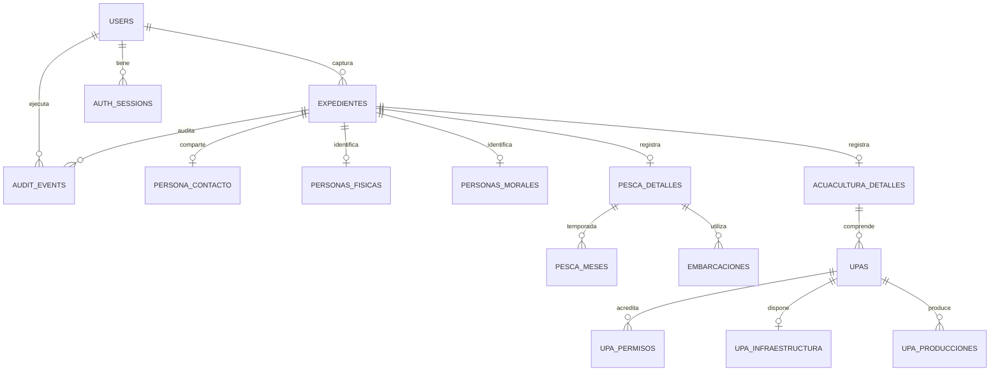

# Diseño de persistencia y gestión de expedientes SIREPES

**Fecha:** 2026-10-16  
**Estado:** Propuesta para revisión  
**Fuentes:** SRS `SRS_Registro_Estatal_Pesca_Acuacultura.docx`, esquema actual PostgreSQL, casos de autenticación y formularios

## Propósito

SIREPES ya utiliza PostgreSQL para cuentas, sesiones y eventos de auditoría, pero los expedientes y borradores permanecen en el estado React del navegador. Esta propuesta define cómo pasar a almacenamiento duradero y cómo relacionar los datos con sus propietarios y permisos, sin perder el esquema actual ni fijar decisiones que el SRS todavía deja pendientes.

También define cómo diagnosticar el error genérico que aparece al crear usuarios. Ese flujo necesita correo SMTP para entregar una contraseña temporal; que PostgreSQL esté disponible no comprueba que el correo o el alta completa hayan funcionado.

## Estado actual y problema del alta de usuarios

La migración `001_users_sessions_audit.sql` ya crea:

- `users`, con roles, estado de cuenta, hash de contraseña y una referencia `created_by` a otra cuenta.
- `auth_sessions`, con una referencia `user_id` a la cuenta propietaria.
- `audit_events`, con `actor_user_id` como referencia a la cuenta que realizó la acción. El objeto auditado se conserva como `target_type` y `target_id` de texto.

El endpoint de alta requiere SMTP configurado. Inserta una cuenta deshabilitada, envía las credenciales temporales y después activa la cuenta y registra el evento. La interfaz muestra el mensaje genérico cuando la API devuelve un error 500. La API incluye `X-Request-Id` en la respuesta, pero el registro de error actual no escribe ese identificador. Por ello, la captura no permite saber si falló la conexión SMTP, la inserción, la activación o la auditoría.

Durante la revisión actual, `/api/ready` respondió que PostgreSQL estaba listo. Eso solo confirma la conexión en ese momento, no durante el intento mostrado en la captura. El siguiente paso de diagnóstico será correlacionar un nuevo intento con su código HTTP, código de error y request ID, sin mostrar ni guardar contraseñas temporales, cookies, tokens, dirección SMTP ni datos completos de cuenta en logs.

## Modelo de datos propuesto

Las cuentas y sesiones existentes se reutilizan. Los expedientes se guardan en tablas nuevas, relacionadas con la cuenta capturista. Las tablas relacionales conservan tipos, claves foráneas y restricciones; JSONB se limita a estado de interfaz/versionado de borrador y metadatos flexibles de auditoría.

### Tablas principales

1. **`expedientes`**: `id` UUID, `modulo` (`pesca`/`acuacultura`), `tipo_persona` (`fisica`/`moral`), `estado` (`borrador`/`finalizado`), `owner_user_id` a `users`, `folio` nullable al inicio, fechas de creación/actualización/finalización y actor creador/actualizador. El propietario no cambia al finalizar. El API aplica los permisos usando propietario, rol y estado en cada operación.
2. **`persona_contacto`**: extensión 1:1 del expediente con domicilio, localidad/municipio, teléfono y correo compartidos por ambos tipos. Mantenerla independiente permite guardar esos campos en borradores aun antes de elegir el tipo de persona, sin forzar una clasificación.
3. **`personas_fisicas`**: extensión 1:1 con nombre, CURP, RFC, nacimiento, sexo y datos de identidad propios de persona física.
4. **`personas_morales`**: extensión 1:1 con razón social, RFC, número de socios, padrón, representante y RNPA.
5. **`pesca_detalles`**: información de permisos/RNPA, estatus, experiencia, especies, producción, ingresos, equipos, lugar de pesca/desembarque y actividad alterna. `pesca_meses` representa la selección de meses como filas (1 a 12); `embarcaciones` representa embarcaciones asociadas sin decidir unicidad hasta confirmar la cardinalidad.
6. **`acuacultura_detalles`**: extensión del expediente acuícola. **`upas`** guarda la unidad, ubicación geográfica y área. **`upa_permisos`** almacena autoridad y referencia del permiso; **`upa_infraestructura`** guarda medidas y equipos; **`upa_producciones`** conserva especie, densidad, ciclo, fases, alimentación y mediciones. Las selecciones múltiples se modelan con tablas hijas cuando sus catálogos sean aprobados.
7. **Catálogos**: municipios/localidades y listas oficiales deben cargarse desde datos validados por SEDER. Se usarán códigos estables y estado activo para no alterar expedientes históricos. No se inventarán catálogos de especies, escolaridad o permisos.
8. **`audit_events`**: se conserva append-only. La migración añade una referencia nullable `record_id`, sin reescribir eventos históricos. No se guardarán contraseñas, CURP/RFC completos ni payloads de formularios en `metadata`.

### Borradores y validación

Los borradores usan las mismas tablas que un expediente finalizado, permitiendo campos nulos mientras se captura. El estado de sección/progreso puede guardarse en columnas versionadas o JSONB pequeño (`form_version`, `completed_sections`), pero no se guardará toda la ficha como JSONB opaco. La finalización cambia el estado y `finalized_at` en una transacción; no se impondrán campos `NOT NULL`, unicidad de CURP/RFC ni reglas de dominio hasta resolver P-09.

No se copiarán datos del estado del navegador: los expedientes actuales son volátiles y no existe fuente persistente que migrar. Al conectar el frontend, cada borrador nuevo y cambio se enviará al API con la sesión vigente; el servidor asignará propietario y rol, ignorando cualquier `owner_user_id` enviado por el navegador.

## Relaciones y permisos

- `users` sigue siendo la autoridad de rol/estado. `expedientes.owner_user_id` tendrá FK restrictiva a `users`, evitando borrar físicamente una cuenta que posee registros.
- Administrador puede consultar todos los expedientes y operar borradores. Capturista puede consultar los expedientes de su propiedad y operar sus borradores. Personal de SEDER consulta finalizados. Invitado no tiene acceso mientras P-01 siga pendiente.
- Por la política temporal más reciente del plan de persistencia, los expedientes finalizados son de solo lectura para todos los perfiles hasta que SEDER confirme P-03 (reapertura). Un diseño anterior del 2026-10-15 permitía al Administrador editar finalizados; esa regla queda en conflicto y no se aplica durante esta etapa.
- Cada endpoint comprueba autorización en el servidor y filtra por propietario/estado en la propia consulta SQL. Ocultar botones no se considera control de acceso.
- Los cambios y consultas que el SRS indique se agregan a la bitácora con actor, expediente, acción y resultado, sin copiar los datos personales.

## Migración incremental

1. No editar ni volver a ejecutar con cambios la migración `001_users_sessions_audit.sql`; el runner comprueba su checksum y las cuentas existentes deben conservarse.
2. Agregar una migración nueva para tablas de expedientes, subtipos, FKs, checks e índices. Añadir referencias nuevas de auditoría como columnas nullable, sin modificar las filas históricas.
3. Aplicar la migración de forma explícita y verificable antes de desplegar la versión del API que la requiere. No borrar tablas, usuarios ni eventos.
4. Implementar y conectar endpoints por etapas: borrador, detalle/actualización, finalización, consulta filtrada y luego PDF individual.
5. Mantener las credenciales y SMTP fuera de las tablas de expedientes; el correo de alta es un servicio separado. Corregir primero la trazabilidad del error genérico para distinguir sus fallos sin exponer secretos.

## Casos de aceptación derivados

- El alta de cuenta informa éxito solo cuando la cuenta queda activa y la entrega de credenciales termina según la política acordada; ante un fallo se puede identificar la fase sin filtrar secretos.
- Un expediente sobrevive a recarga y a una nueva sesión autorizada; un borrador conserva propietario, módulo y progreso.
- Un capturista no puede leer ni modificar el borrador de otra cuenta llamando directamente a la API.
- Personal de SEDER no recibe borradores; Invitado no puede editar ni descargar PDFs.
- Finalizar impide cambios de Capturista; las operaciones administrativas autorizadas quedan auditadas.
- Toda relación de cuenta/sesión/expediente valida su FK y los valores de estado/módulo se limitan a los dominios aprobados.

## Decisiones que deben confirmarse con SEDER

La matriz del SRS aún marca estas reglas como preguntas abiertas; la migración no debe codificarlas como definitivas sin validación:

- P-01: si Invitado inicia sesión y qué campos puede consultar.
- P-02: si Capturista ve registros finalizados de otros capturistas.
- P-03: quién y cómo reabre expedientes finalizados.
- P-04: eliminación física, baja lógica o solo desactivación administrativa.
- P-05: perfiles autorizados para PDF.
- P-06/P-07: flujo de restablecimiento de contraseña y gestión del perfil Administrador.
- P-08: significado de “Motor FB.” y del estatus “Libre”.
- P-09: obligatoriedad, rangos, validaciones y claves únicas en formularios.
- P-10: anexos de documentos y detalle/listado de socios.
- P-11: integraciones con CONAPESCA/RNPA.
- P-12: volumen esperado, alojamiento y respaldo.
- P-13: si se limita a una persona usuaria a Pesca o Acuacultura.
- P-14: normativa, aviso de privacidad, retención y tratamiento de datos personales.

La finalización cambia el estado de forma transaccional, pero no exige campos que el SRS aún no declara obligatorios; se requiere resolver P-09 antes de añadir esa validación.

Los umbrales de 5 intentos, los 30 minutos de inactividad y otros valores marcados “Propuesto” en el SRS no se convierten en defaults nuevos hasta que SEDER los apruebe.

## Alcance de esta propuesta

La implementación crea una migración aditiva y endpoints protegidos, pero no aplica la migración en esta etapa. Tampoco modifica la migración 001 ni datos existentes, no cambia credenciales ni envía correos. El administrador debe aplicar explícitamente la migración después de revisar la configuración local de PostgreSQL.
